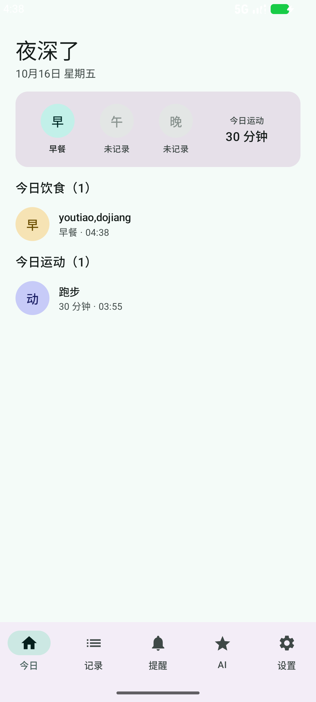
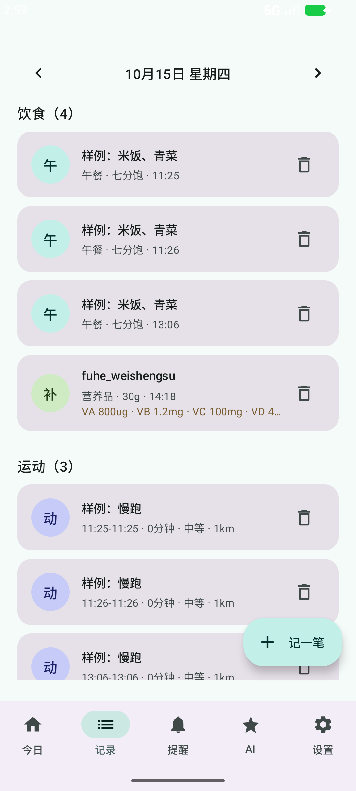
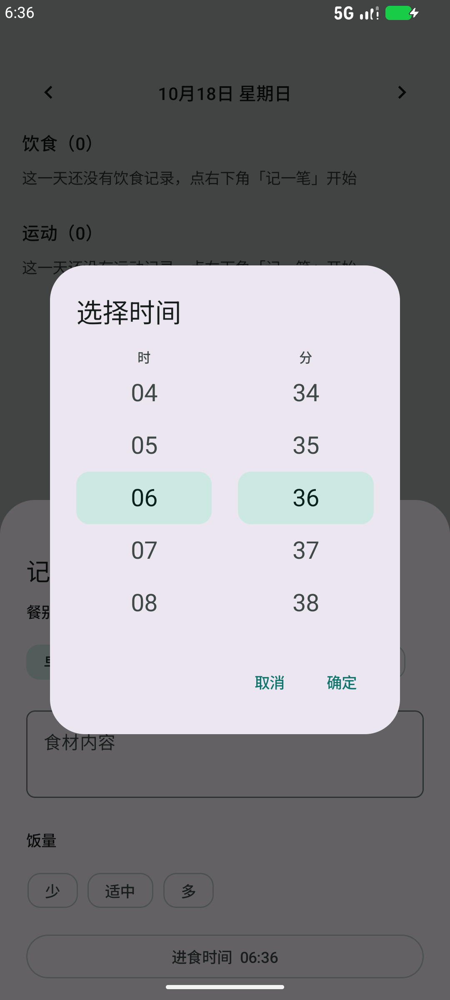
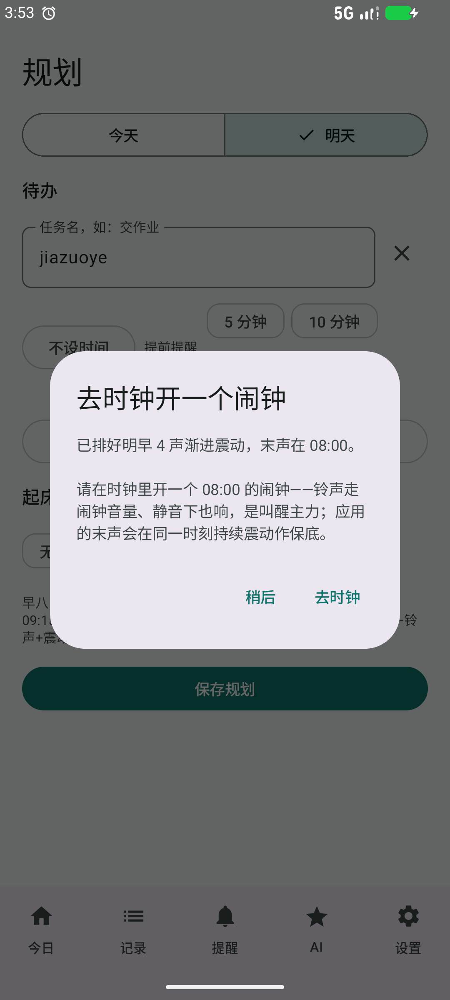
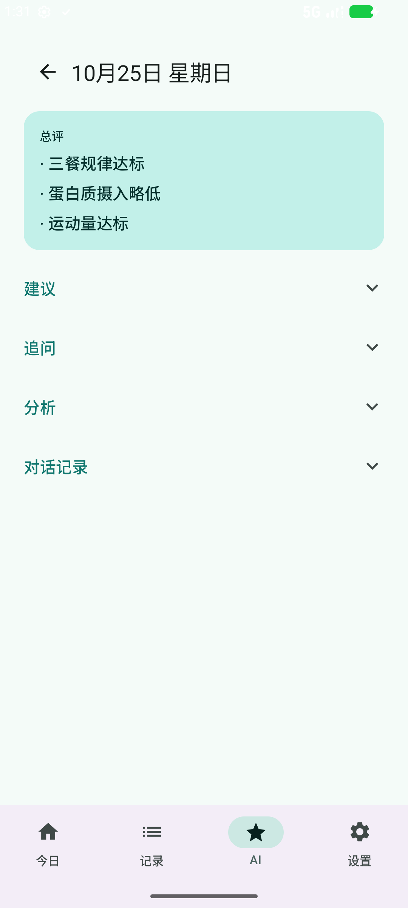
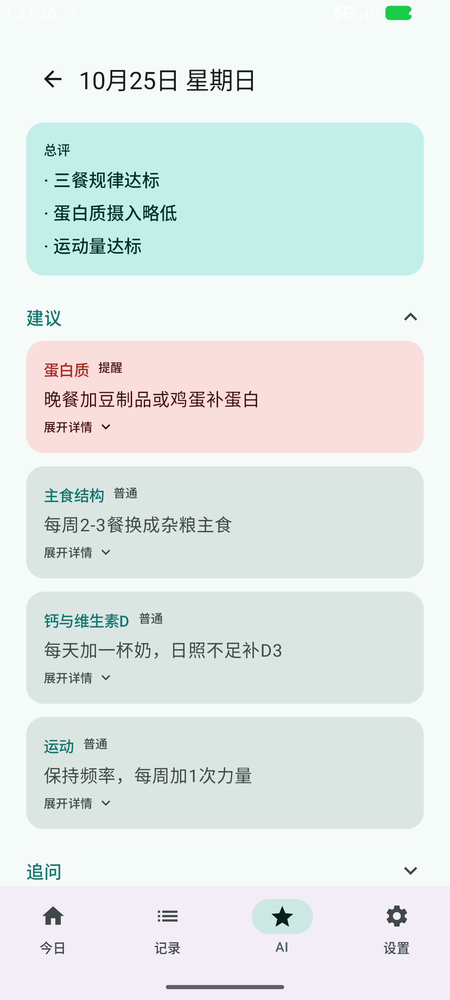

# 每日掌控 · control-your-life

把手机变成掌控生活的工具：记录饮食与运动，到点提醒三餐、背单词与次日安排，用「系统闹钟 + 应用震动」双保险把你从床上叫起来。

> 仓库主人大学专业为集成电路（IC），并非计算机科班出身；本工程从零到一纯 vibe coding 完成，存在诸多不专业之处，虚心接受批评和建议。

一款个人生活管理 Android 应用——数据全部存在本地，无账号、无云同步、不追踪。唯一的网络出口是你自己配置的 AI 接口（仅用于每日汇总生成建议报告）。数据存哪、怎么备份带走见 [docs/data-storage.md](docs/data-storage.md)（应用内置一键导出/恢复与每周自动备份）。

## 最近更新

### v0.4.1（2026-10-26）· AI 更懂你：追问、定制与长期习惯导向

**新增**

- **AI 追问**：报告可附带 AI 就不完整信息提出的问题（身高体重、昨晚睡眠等），AI 页横幅直达、详情内顺手作答，回答随次日报告提交——档案型答案答一次长期携带、AI 不再重复问；「个人档案」与「问答历史」全程透明可改可回看
- **提示词应用内定制（高级）**：设置 → AI 接口 → 提示词定制——完整 system 提示词可编辑，保存即生效、一键恢复默认、随备份导出；改动 JSON 输出格式约定会触发红色警告二次确认（防改坏报告拆解）
- **长期习惯导向**：上行数据新增「近90天长期概要」（与近30天概要双窗口），建议以可长期坚持的习惯养成为主、单日显著异常纠正为辅

**改进**

- **报告详情重排**：总评改为分点概括卡，内容整理为建议 / 追问 / 分析 / 对话记录四个可折叠板块，一屏看清结构
- **设置页分组化**：七段平铺长页改为「六组入口 + 子页面」，带实时状态摘要

> 0.4 系列各版本的完整更新与开发记录：[docs/release-notes/0.4.md](docs/release-notes/0.4.md) · 全部历史版本：[CHANGELOG.md](CHANGELOG.md) · 第一次使用？看[新手上手指南](docs/getting-started.md)

## 接下来的计划

- 报告质量与追问质量持续观察调优（提示词在应用内即可定制，无需改代码）
- 待办池：NRV 包装食品营养成分表录入、UI 精修专项、AI 压缩滚动档案等

> 更多待办与远景规划见 [docs/roadmap.md](docs/roadmap.md)。

## 界面

| 今日概览 | 记录与滚轮时间 |
|:---:|:---:|
|  |  |

| 滚轮时间选择 | 起床双保险引导 |
|:---:|:---:|
|  |  |

| AI 每日报告：分点总评 + 四大板块 | 展开建议：行动摘要 + 依据折叠 |
|:---:|:---:|
|  |  |

## 构建与安装

| 方式 | 适合谁 |
|---|---|
| Android Studio 打开运行 | 想看代码、改代码的开发者（最省事） |
| 命令行 Gradle 构建 + adb 安装 | 熟悉终端的开发者 |
| 直接安装 APK | 只想用的普通用户（正式版将挂 GitHub Releases） |

> 每种方式的逐步操作、每一步的预期输出、可预见的非预期行为与解决办法，见 **[docs/build-and-install.md](docs/build-and-install.md)**；装好后怎么开始用，看[新手上手指南](docs/getting-started.md)。想省事：双击仓库里的 `script/check-env.bat` 一键自检环境，双击 `script/build-app.bat` 一键构建出 APK。设备要求：Android 15 及以上。

## 技术栈与工程

- Kotlin + Jetpack Compose + Material 3；单模块、无第三方 UI 依赖
- Room（数据库，显式迁移）+ DataStore（轻量设置）
- AlarmManager 精确闹钟 + 通知深链导航

工程分层与模块关系见 [docs/architecture.md](docs/architecture.md)，更多文档索引见 [docs/README.md](docs/README.md)。项目按阶段开发，阶段报告存于 [docs/reports/](docs/reports/)，更新日志见 [CHANGELOG.md](CHANGELOG.md)。

## 开发模型

本工程由仓库主人与 AI 结对完成（vibe coding）。使用过的模型：

- **GLM-5.3** —— 截至目前唯一在此署名的模型，本工程的全部代码与文档均与其协作完成

## 许可

[MIT](LICENSE)
